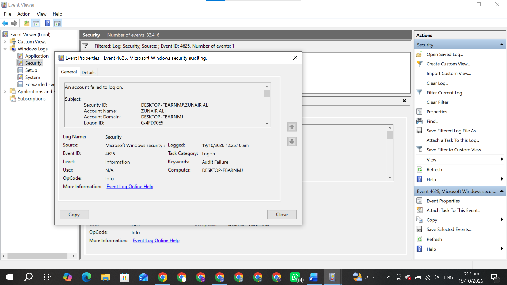

# Windows Failed Login Analysis

## Project Overview
This project focuses on identifying and analyzing failed login attempts in Windows using Event Viewer security logs.

## Objective
- Identify failed login attempts.
- Understand Windows security events.
- Learn basic security monitoring and log analysis.

## Tools Used
- Windows Event Viewer
- Windows Security Logs
- GitHub

## Event ID
**4625** — An account failed to log on.

## Analysis Process
1. Open Windows Event Viewer.
2. Navigate to Windows Logs → Security.
3. Filter the logs using Event ID 4625.
4. Review the available event details.

## Skills Learned
- Windows log analysis
- Basic cybersecurity monitoring
- Security event identification

## Disclaimer
This project is for educational purposes and uses Windows security logs for learning and analysis.
## Practical Evidence

